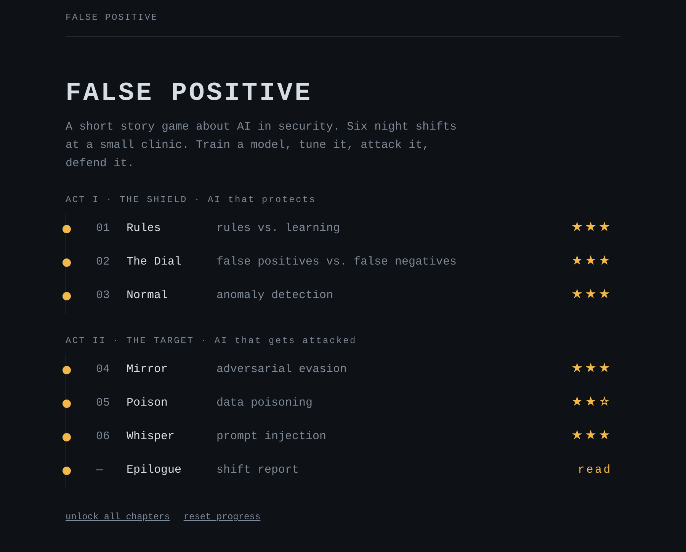
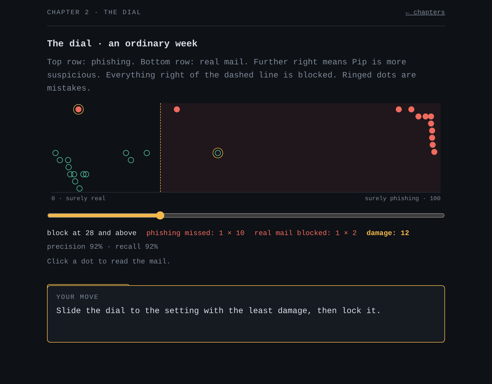

# False Positive

A short story game about AI in security. You spend six night shifts on the security desk of a small clinic, where you train a tiny AI called Pip, tune it, attack it, and defend it.

No frameworks, no libraries, no build step. It is plain HTML, CSS and JavaScript, and the machine learning is written from scratch.



## Play

1. Download or clone this repository.
2. Open `index.html` in a browser.

That is all. A full run takes about 15 to 20 minutes. Progress is saved in the browser.

- Add `?fast` to the address (`index.html?fast`) to turn off the typewriter effect.
- "unlock all chapters" on the menu lets you jump to any chapter, which is handy for a demo.
- If you prefer a local server: `python3 -m http.server 8000`, then open `http://localhost:8000`.

## The idea

"AI in security" is usually explained with buzzwords. I wanted something you can play instead, where every idea is a small thing you do with your own hands and then see the result of.

The game has two acts, because the topic has two sides:

- **Act I, the shield.** AI is used to protect a system.
- **Act II, the target.** The AI itself becomes the thing that gets attacked.

| # | Chapter | Concept | What you do |
|---|---------|---------|-------------|
| 1 | Rules | Rules vs. machine learning | Write a block-list, watch it fail, then teach a classifier by labelling mails |
| 2 | The Dial | False positives vs. false negatives | Move the alert threshold and try to minimise the damage |
| 3 | Normal | Anomaly detection | Decide how wide "normal" is, then watch a day of logins |
| 4 | Mirror | Adversarial evasion | Play the attacker and sneak a phishing mail past your own model |
| 5 | Poison | Data poisoning | Find the fake reports that are corrupting the training data |
| 6 | Whisper | Prompt injection | Decide what an AI assistant may do without asking a human |



## What is real and what is simulated

I think this matters, so here it is plainly.

- **Chapters 1, 2, 4 and 5 run a real Naive Bayes classifier** ([`js/core/bayes.js`](js/core/bayes.js)). It is trained in your browser on 52 short mails and tested on 26 mails it has never seen. Every number on screen is computed live. Nothing is scripted to come out a certain way.
- **Chapter 3 runs a real anomaly detector** ([`js/core/anomaly.js`](js/core/anomaly.js)) based on z-scores, fitted on 60 generated logins.
- **Chapter 6 is a scripted simulation.** There is no language model in the game. The "assistant" obeys any instruction it reads, on purpose, because that failure is what the chapter is about.
- The mails are written for the story. With 78 mails in total this is a teaching toy, not a spam filter you should use.

## How it is built

```
index.html            the page: a stage, a dialogue box, and script tags
css/style.css         one dark theme
js/
  core/
    util.js           seeded random numbers, small helpers
    bayes.js          tokenizer + Naive Bayes classifier
    metrics.js        confusion matrix, precision, recall
    anomaly.js        z-score anomaly detector
  data.js             the mails and the scenario for every chapter
  ui.js               tiny engine: DOM helper, dialogue box, waiting for the player
  chapters/           one file per chapter
  main.js             menu, progress, chapter flow
tests/                unit tests and "story tests"
```

Three decisions shaped the code:

1. **Logic is kept away from the page.** Everything in `js/core/` and `js/data.js` never touches the DOM, so Node can load the exact same files and test them.
2. **A chapter is one async function.** The story reads top to bottom: `await ui.say('asha', '...')`, then `await` the player's move, then the next line. All waiting goes through one function (`ui.wait`), so leaving a chapter half-way cancels it cleanly.
3. **Plain `<script>` tags, not ES modules.** Modules do not load from `file://` in most browsers, and I wanted the game to start by double-clicking one file.

## Tests

```bash
node --test
```

Needs Node 18 or newer, and nothing else. There are 25 tests of two kinds:

- **Unit tests** ([`tests/core.test.js`](tests/core.test.js)) for the tokenizer, the classifier, the metrics and the anomaly detector.
- **Story tests** ([`tests/story.test.js`](tests/story.test.js)). Each chapter makes a claim, for example "no threshold is free of mistakes" or "the puzzle can be solved in 6 moves but not in 5". These tests check that every claim is actually true for the data in the game, so editing the mail lists cannot silently break a lesson.

## Design notes

- **Naive Bayes is overconfident.** It treats every word as independent proof, so raw scores pile up near 0 and 100, which leaves nothing to tune in the threshold chapter. Dividing the log-odds by a "temperature" spreads the scores out without changing which side of 50 a mail lands on.
- **All "random" data is seeded.** The logins in chapter 3 come from a seeded generator, so every player sees the same day and the story tests can check exact outcomes.
- **Poisoning needs volume.** A handful of mislabelled mails barely moves the model. It only breaks once each fake report is repeated about 20 times, so the chapter has the attacker use many fake accounts, and the "reported by" column becomes the clue.

## Limits and ideas

- The dataset is tiny and hand-written, so the model has odd habits (it thinks the word "your" is suspicious). The game points this out instead of hiding it.
- The anomaly detector treats features as independent. A proper one would use covariance (Mahalanobis distance) or an isolation forest.
- Chapter 6 could use a real small language model to show injection on something that is not scripted.
- No sound, and the layout is only lightly tuned for phones.

## License

MIT. See [LICENSE](LICENSE).
